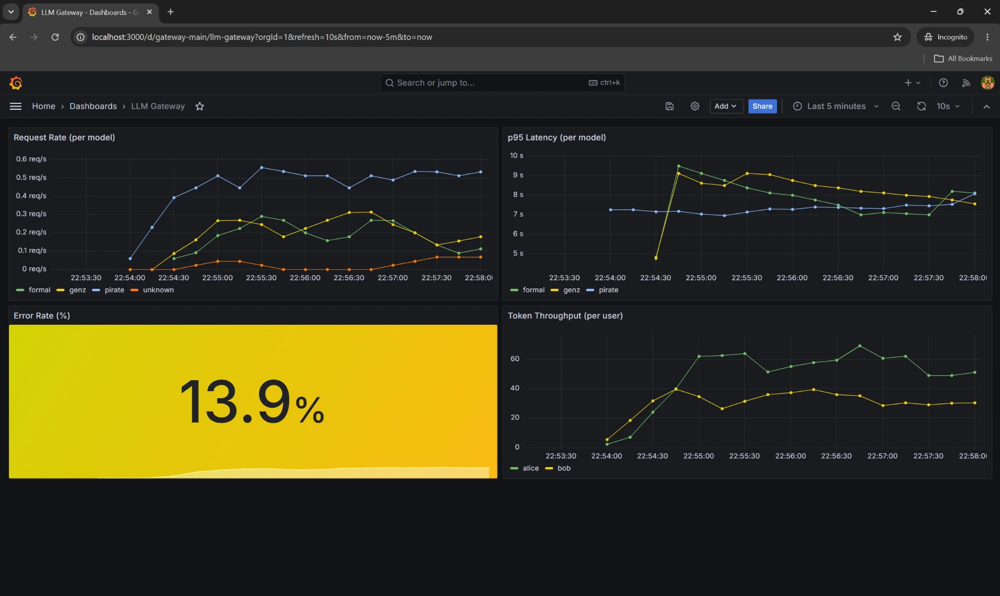

# llm-gateway-pro

A self-contained LLM serving stack. One small base model hot-swaps between three fine-tuned personalities on request, sits behind an authenticated gateway with rate limiting and request logs, is driven by a web chat UI, and reports itself to Prometheus and Grafana.



## Why this exists

Serving a language model in production is rarely about the model. It's about everything around it: who's allowed to call it, how fast they're allowed to call it, where the logs go, which personality or fine-tune you route to, and whether you can tell at a glance that the whole system is healthy. This project builds that scaffold around a tiny Qwen 2.5 base so each piece stays legible.

Three ideas drove the design:

- **One base, many personalities.** Instead of running a separate process per fine-tune, a single vLLM worker loads the base model once and keeps a handful of LoRA adapters hot-swappable. Callers pick the personality by sending it as the `model` field — the same way they'd pick a model from a provider API.
- **A gateway, not a proxy.** The gateway is the only thing clients talk to. It authenticates, authorizes per user per model, counts recent calls for a rate limit, forwards to vLLM, logs the result, and exposes Prometheus metrics. The business logic lives here, not in the model server.
- **The dashboard is the demo.** Request rate, p95 latency, error percentage, and tokens per user are the four things an on-call engineer would want on one screen. The dashboard is provisioned from a JSON file in the repo — no clicking in the UI, no state to lose.

## How it fits together

```
            Streamlit chat UI
                  │
                  ▼
           ┌──────────────┐
           │   Gateway    │  auth · access · rate limit · logs · metrics
           └──────┬───────┘
                  │
                  ▼
           ┌──────────────┐
           │     vLLM     │  base model + hot-swappable LoRA adapters
           └──────────────┘

           Prometheus ◄── scrapes /metrics every 15s
               │
               ▼
            Grafana  ◄── dashboard JSON mounted from the repo
```

The gateway, frontend, Prometheus, and Grafana all run as containers from the single `docker-compose.yml` at the project root. vLLM runs on the host because it needs the GPU directly.

## The pieces

### The personalities

Three LoRA adapters are trained on top of `Qwen/Qwen2.5-0.5B-Instruct`:

- **pirate** — pirate speech
- **genz** — Gen Z slang
- **formal** — professional tone

They were trained with Unsloth's QLoRA path (4-bit base, low-rank adapters) against a small synthetic dataset — a few dozen everyday questions, with the "correct" answer for each personality generated by a larger model. The point is the serving pattern, not the quality of the fine-tune, so the dataset stays tiny on purpose. See `finetuning/`.

### The gateway

A FastAPI service that implements enough of the OpenAI `chat/completions` schema to be a drop-in base URL for the OpenAI SDK. On every request it:

1. Reads the `Authorization: Bearer <key>` header and looks the key up in SQLite.
2. Checks that the user is allowed to use the requested personality.
3. Checks a rolling count of their recent requests against their rate limit.
4. Forwards the request to vLLM, streaming or not.
5. Logs the outcome and increments Prometheus counters.

Streaming is implemented as a passthrough: the gateway opens an SSE stream to vLLM with `include_usage` enabled, pipes each chunk through to the client, and uses the final usage chunk to log token counts after the stream closes.

### The data layer

Two tables in SQLite:

- `users` — api_key, rate_limit, which personalities they can call.
- `request_logs` — one row per completed request with user, personality, prompt/completion tokens, latency, status.

The rate limiter reads straight from `request_logs` instead of keeping an in-memory bucket, which keeps the whole gateway stateless and container-restart-safe.

### The frontend

A single-file Streamlit app that acts as a visible client against the gateway. It lets you pick a personality, type a message, and watch the response stream in. It's intentionally thin — the interesting code is behind it.

### The observability

The `metrics.py` module declares three Prometheus series:

- `gateway_requests_total` — counter, labeled by user, model, status.
- `gateway_request_duration_seconds` — histogram, labeled by user and model.
- `gateway_tokens_total` — counter, labeled by user, model, and type (prompt vs completion).

The Grafana dashboard reads these and renders four panels: request rate per personality, p95 latency per personality, overall error percentage, and token throughput per user. Everything in `monitoring/grafana/` is loaded on container start, so the dashboard is version-controlled with the rest of the repo.

## Running it

### Prerequisites

- An NVIDIA GPU with enough VRAM to hold the base model plus a handful of small adapters. A laptop 4060 is plenty.
- Docker Desktop with the WSL2 backend.
- A Python environment with vLLM installed, for the host-side model server.

### First run

Train the adapters once (this takes a while):

```bash
cd finetuning
python generate_data.py        # needs ANTHROPIC_API_KEY in .env
PERSONALITY=pirate python train_lora.py
PERSONALITY=genz   python train_lora.py
PERSONALITY=formal python train_lora.py
```

### Every run

Start vLLM on the host (it needs the GPU):

```bash
./finetuning/serve.sh
```

Bring up everything else:

```bash
docker compose up --build
```

That gives you:

- The gateway at `http://localhost:8000`
- The chat UI at `http://localhost:8501`
- Prometheus at `http://localhost:9090`
- Grafana at `http://localhost:3000` (default login `admin`/`admin` unless overridden in `.env`)

## Talking to it

The gateway speaks the OpenAI API, so any client that lets you set a base URL and an API key works:

```python
from openai import OpenAI

client = OpenAI(base_url="http://localhost:8000/v1", api_key="sk-alice-dev-key")

resp = client.chat.completions.create(
    model="pirate",
    messages=[{"role": "user", "content": "Explain WiFi."}],
    stream=True,
)
for chunk in resp:
    if chunk.choices[0].delta.content:
        print(chunk.choices[0].delta.content, end="", flush=True)
```

The seeded users for local dev are `alice` (all three personalities) and `bob` (pirate only). Both have intentionally low rate limits so the 429 path is easy to see from the chat UI; raise them in `app/database.py` if you want to drive load tests.

### Load generator

`scripts/load_gen.py` fires a mix of valid requests, forbidden-model attempts, and bad-key hits for a configurable duration. It's the easiest way to put signal on the Grafana dashboard:

```bash
python scripts/load_gen.py 300 4
```

## Layout

```
llm-gateway-pro/
├── app/              # gateway, frontend, config, database, metrics
├── finetuning/       # dataset synth, LoRA training, vLLM launcher
├── scripts/          # smoke tests, load generator
├── monitoring/       # Prometheus config, Grafana datasources + dashboard
├── docker/           # Dockerfiles for the gateway and frontend
├── docs/             # dashboard screenshot
├── docker-compose.yml
├── requirements.txt
├── .env.example
└── README.md
```

The things that need a GPU or that produce large artifacts (`finetuning/data/`, `finetuning/adapters/`, `finetuning/outputs/`) are gitignored. Copy `.env.example` to `.env` and fill in the Anthropic key before running the data generator.

## Known limits

- The rate limiter queries SQLite on every call. Fine for a single-box demo; not fine as-is for scale.
- Request logging is synchronous. A fire-and-forget writer or a batched flush would be the next change.
- API keys are stored as plaintext in SQLite because the seed script is the only way they're ever written. A real deployment would hash them and keep the plaintext only in the client.
- vLLM runs on the host rather than in a container to avoid the NVIDIA container toolkit setup. Fine for local; a production deployment would run it as a GPU container on the same orchestrator.
